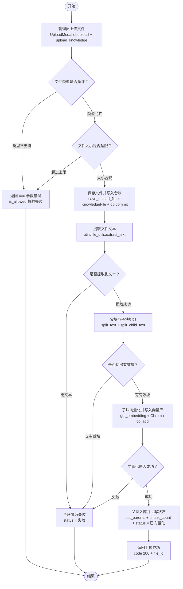
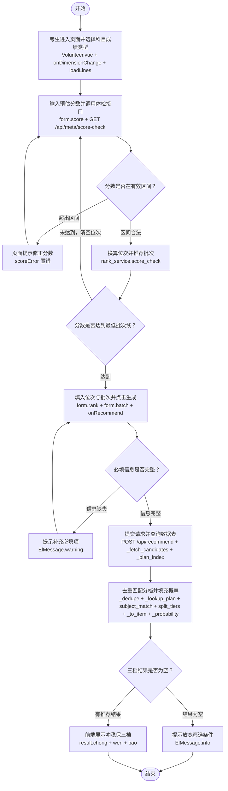

# RAG 功能流程图

## 基础 RAG 流程图

```mermaid
flowchart TD
    ST([开始]) --> A[用户提交问题<br/>POST /api/ai/chat]
    A --> B[进入检索入口<br/>rag_service.search(query, top_k)]
    B --> C[向量化并相似度检索<br/>get_embedding + dense_search]
    C --> D[关键词检索<br/>bm25_search]
    D --> E[两路排序融合<br/>rrf(k=RRF_K)]
    E --> F{是否召回候选？}
    F -- 无候选 --> G[关键词打分兜底<br/>_keyword_fallback]
    G --> H[精排重排序<br/>rerank(query, hits)]
    F -- 有候选 --> H
    H --> I[子块回填父块<br/>_expand_to_parents]
    I --> J{上下文是否为空？}
    J -- 为空 --> K[返回拒答话术<br/>OFF_TOPIC_ANSWER]
    K --> Z([结束])
    J -- 非空 --> L[拼接上下文并组装提示词<br/>generate_answer(query, context)]
    L --> M[调用大模型生成<br/>ai_service.ask(temperature=0.1, top_p=0.3)]
    M --> N[返回答案与来源<br/>answer + sources]
    N --> Z
```

## 进阶 RAG 流程图

```mermaid
flowchart TD
    ST([开始]) --> A[用户提交问题<br/>POST /api/ai/chat]
    A --> B[按问题特征选择策略<br/>answer_with_strategy + route_strategy]
    B --> C{问题属于哪一类？}
    C -- 判断确认类 --> D[Self-RAG：检索后自评<br/>SelfRAG(_retrieve, _generate).run()]
    C -- 复合多实体类 --> E[Corrective：相关性过滤<br/>CorrectiveRAG(_retrieve, _generate).run()]
    C -- 其余常规类 --> F[标准链路：直接生成<br/>_retrieve + _generate]
    D -->|自评不合格，反思后重试| D
    E -->|全部不相关，重写后重试| E
    D -->|高级链路异常，回落标准| F
    E -->|高级链路异常，回落标准| F
    D --> G[共用检索入口<br/>rag_service.search(query, top_k)]
    E --> G
    F --> G
    G --> H[检索前预处理<br/>QueryPreprocessor.process()]
    H --> I[多路召回融合<br/>MultiRecall.rrf_fusion()]
    I --> J[精排与父块回填<br/>rerank + _expand_to_parents]
    J --> K{上下文是否为空？}
    K -- 为空 --> L[返回拒答话术<br/>OFF_TOPIC_ANSWER]
    L --> Z([结束])
    K -- 非空 --> M[防幻觉生成<br/>generate_answer(temperature=0.1, top_p=0.3)]
    M --> N[返回答案与策略步骤<br/>answer + strategy + steps]
    N --> Z
```

## 知识图谱 RAG 流程图

```mermaid
flowchart TD
    ST([开始]) --> A[用户提交问题<br/>POST /api/ai/chat use_graph=true]
    A --> B[双通道问答主流程<br/>answer_with_graph + search_with_graph]
    B --> C[图谱通道<br/>GraphQueryEngine.query(question)]
    B --> D[向量通道<br/>search + QueryPreprocessor + MultiRecall + rerank]
    C --> E[实体识别与消歧<br/>EntityExtractor.extract + canonicalize]
    E --> F[生成查询语句<br/>get_schema + CypherGenerator.generate]
    F --> G[执行查询并绑定参数<br/>execute_cypher + build_params]
    G --> H[格式化结构化记录<br/>_format_records]
    D --> I[按优先级与配额融合<br/>_truncate_by_tokens + _build_priority_hint]
    H --> I
    I --> J{两路是否都未命中？}
    J -- 都未命中 --> K[直接返回拒答话术<br/>不调用大模型]
    K --> Z([结束])
    J -- 至少一路命中 --> L[组装融合提示词<br/>GRAPH_FUSION_PROMPT.format]
    L --> M[调用大模型生成<br/>ai_service.ask(temperature=0.1, top_p=0.3)]
    M --> N[返回答案与图谱调试信息<br/>graph_hit + graph_cypher]
    N --> Z
```

## 知识库上传流程图



## 项目志愿填报流程图


