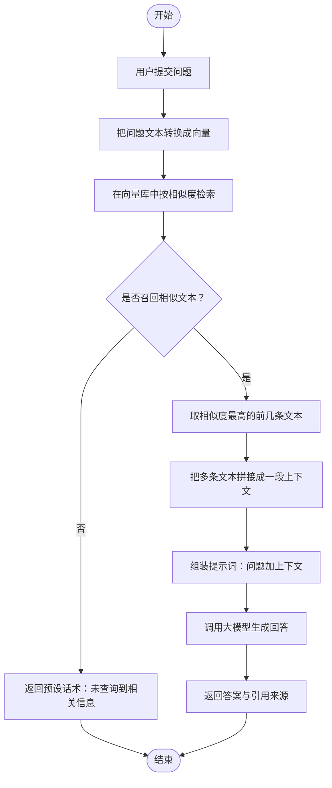
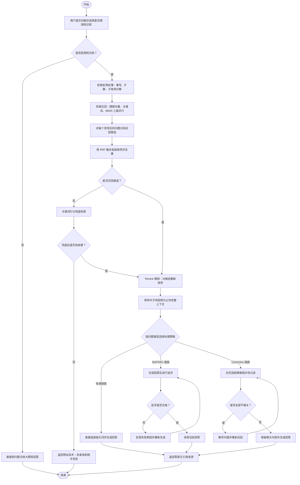
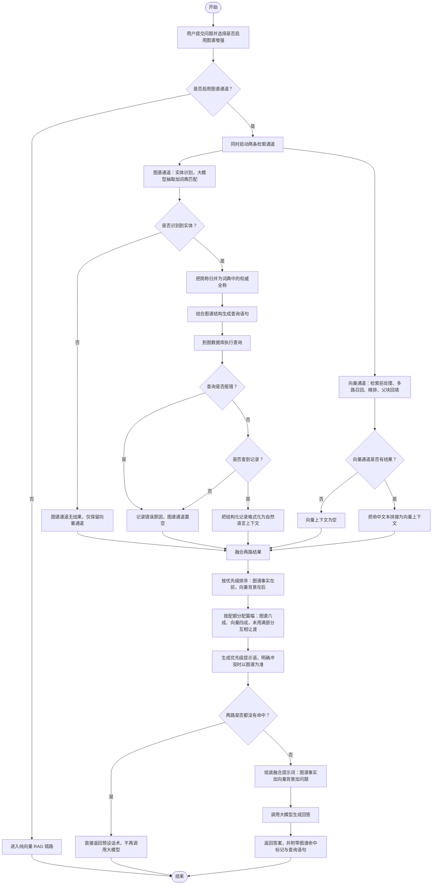
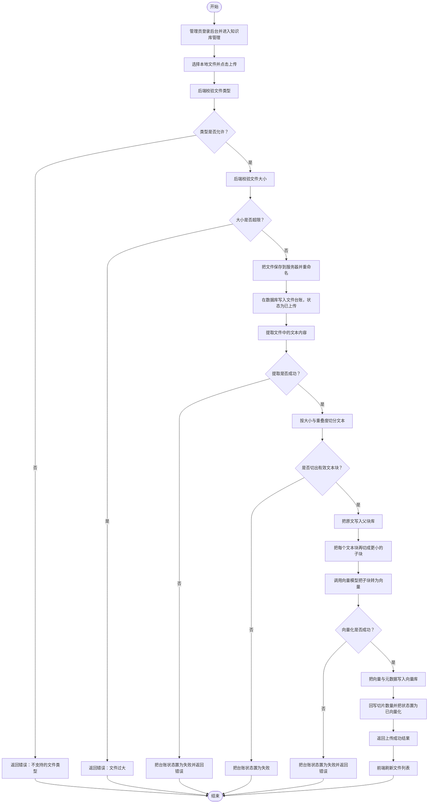
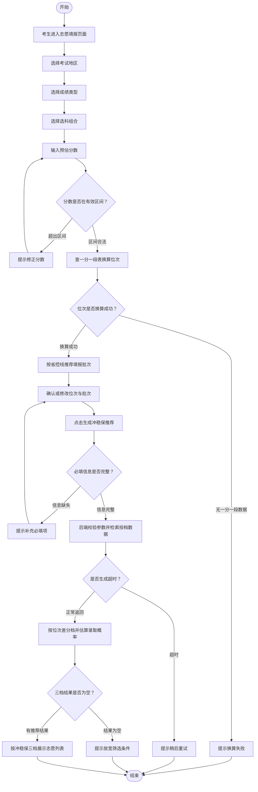

# RAG 流程图文档

> 适用项目：`gaokao_project`（高考志愿填报系统）
> 覆盖范围：基础 RAG、进阶 RAG、知识图谱 RAG、知识库上传（后台功能）、志愿填报推荐（核心业务）
> 图形语法：Mermaid `flowchart`（自上而下）
> 阅读约定：
> - 圆角节点 `([...])` 表示**开始 / 结束**；
> - 菱形节点 `{...}` 表示**判断分支**；
> - 矩形节点 `[...]` 表示**处理步骤**；
> - 每个节点都标注了去向，可以回到上游形成循环，也可以直达结束，不存在悬空节点。

---

## 目录

| 编号 | 流程图 | 对应版本 | 入口 |
|---|---|---|---|
| 一 | 基础 RAG（Naive RAG） | 0.1.0 | `/api/ai/chat` |
| 二 | 进阶 RAG（Advanced RAG） | 0.2.0 – 0.7.2 | `/api/ai/chat` |
| 三 | 知识图谱 RAG（GraphRAG） | 0.9.0 | `/api/ai/chat`（`use_graph=true`） |
| 四 | 知识库上传（后台功能） | 0.2.0 起持续演进 | `/api/knowledge/upload` |
| 五 | 志愿填报推荐（核心业务） | 0.2.0 起持续演进 | `/api/recommend` |

---

## 一、基础 RAG（Naive RAG）流程图

### 1.1 流程图

### 1.2 流程说明

| 节点 | 含义 |
|---|---|
| 用户提交问题 | 前端问答页把问题发到后端问答接口 |
| 把问题文本转换成向量 | 用向量模型把问题编码成一组浮点数 |
| 在向量库中按相似度检索 | 拿问题向量和库内所有切片算相似度，取最接近的一批 |
| 取相似度最高的前几条文本 | 控制送给大模型的篇幅，避免上下文过长 |
| 拼接成一段上下文 | 多条切片用换行拼成一整段背景材料 |
| 组装提示词 | 把问题和背景材料按固定模板拼成最终提示词 |
| 调用大模型生成回答 | 由大模型基于背景材料作答，禁止脱离材料编造 |
| 返回答案与引用来源 | 一并回传命中的文件名，方便用户核对 |

### 1.3 设计局限

基础 RAG 只有「检索 + 生成」两步，存在三个典型问题：问题表述不佳就检索不准；向量相似不代表内容正确；命中的是碎片切片，缺乏完整上下文。后续版本针对这三点分别做了检索前预处理、多路召回与精排、父子块切分，也就是下面的进阶 RAG。

---

## 二、进阶 RAG（Advanced RAG）流程图

### 2.1 流程图

### 2.2 流程说明

| 阶段 | 节点 | 含义 |
|---|---|---|
| 入口 | 是否启用知识库 | 用户可以只用大模型，也可以叠加知识库增强 |
| 检索前 | 重写、扩展、子查询分解 | 把口语化问题改写成更适合检索的形式，或拆成多个子问题分别检索 |
| 检索中 | 三路并行召回 | 语义相近的、字面重合的、BM25 词频的三条路同时找，避免单一路漏召回 |
| 检索中 | 多问题分别召回 | 每个改写后的问题都独立跑一遍召回，扩大候选面 |
| 检索中 | RRF 融合去重 | 把多路多问题的排序按倒数排名融合，合并成一份候选清单 |
| 检索后 | Rerank 精排 | 对候选做一次更精细的相关性打分，把真正相关的排到前面 |
| 检索后 | 父子块回填 | 检索时匹配的是小块，最终送给大模型的是它所属的完整大块，保证上下文完整 |
| 兜底 | 关键词打分检索 | 向量与 BM25 都没结果时，退回到最基础的字面匹配 |
| 生成 | 策略路由 | 按问题类型决定走标准链路、Self-RAG 还是 Corrective RAG |
| 生成 | Self-RAG 自评 | 生成后自我检查是否切题、是否有依据，不合格就反思重来 |
| 生成 | Corrective 相关性过滤 | 先判断召回内容是否相关，全部不相关就重写问题再检索一轮 |

### 2.3 三条链路的差异

| 链路 | 关注点 | 失败时的动作 |
|---|---|---|
| 标准链路 | 检索完直接生成 | 无自检，靠检索质量兜底 |
| Self-RAG | 生成后再自评 | 反思失败原因，重新生成 |
| Corrective RAG | 先验召回质量 | 全部不相关则重写问题，重新召回 |

> 三条链路共用同一个检索入口，差别只在「拿到上下文之后怎么生成、要不要反思或纠偏」。
> 任一高级链路异常时都会自动回落到标准链路，保证问答不中断。

---

## 三、知识图谱 RAG（GraphRAG）流程图

### 3.1 流程图

### 3.2 流程说明

| 阶段 | 节点 | 含义 |
|---|---|---|
| 入口 | 是否启用图谱通道 | 开关关闭时走纯向量链路，行为与此前版本完全一致 |
| 调度 | 同时启动两条通道 | 图谱与向量并行执行，谁也不等谁，缩短整体耗时 |
| 图谱 | 实体识别 | 大模型负责理解问句里的实体，词典负责精确匹配院校名、专业名，两路合并后词典结果优先 |
| 图谱 | 简称归并 | 大模型可能只抽出「计算机」，需要借助词典归并成「计算机科学与技术」才能查到节点 |
| 图谱 | 生成查询语句 | 把识别出的实体和图谱结构一起交给大模型，生成图数据库的查询语句 |
| 图谱 | 执行查询 | 到图数据库按院校、专业、关系、属性查精确事实 |
| 图谱 | 记录格式化 | 把返回的结构化字段转成通顺的中文句子，方便大模型阅读 |
| 向量 | 复用进阶链路 | 与进阶 RAG 完全相同的检索前、多路召回、精排、父子块回填 |
| 融合 | 按优先级排序 | 图谱上下文排在前，向量上下文排在后，位置即优先级 |
| 融合 | 按配额分配篇幅 | 总篇幅固定，图谱最多占六成、向量最多占四成；某一路没用满，剩余额度让给另一路 |
| 融合 | 生成优先级提示语 | 明确告诉大模型：图谱是权威事实，与向量背景冲突时以图谱为准 |
| 出口 | 两路都没命中 | 不再调用大模型，直接返回预设话术，节省一次网络往返 |

### 3.3 命中组合与提示语

| 图谱命中 | 向量命中 | 采用策略 |
|---|---|---|
| 是 | 是 | 图谱在前，冲突时以图谱为准 |
| 是 | 否 | 严格基于图谱回答，禁止编造 |
| 否 | 是 | 基于向量背景回答，找不到就明确说明 |
| 否 | 否 | 直接返回预设话术，不调用大模型 |

### 3.4 为什么不做分数融合

图谱返回的是**对或错的精确事实**，例如学费、最低分、选科要求，本身没有分数概念；向量返回的是**语义相近的文本**，有相似度但无法保证数字准确。两者的量纲不可比，把向量相似度和一条完全正确的图谱事实放在一起排序没有意义。因此采用「优先级 + 篇幅配额」的融合方式，而不是加权求和的分数融合。

---

## 四、知识库上传流程图（后台功能）

### 4.1 流程图

### 4.2 流程说明

| 阶段 | 节点 | 含义 |
|---|---|---|
| 上传前 | 类型校验 | 仅允许规定格式的文件，例如 PDF、Word、纯文本 |
| 上传前 | 大小校验 | 超过上限直接拒绝，避免占满磁盘与内存 |
| 落盘 | 保存并重命名 | 文件统一重命名后存放，避免原始文件名冲突或注入风险 |
| 落盘 | 写入台账 | 数据库记录文件名、大小、上传者、初始状态，后续删库可据此回溯 |
| 解析 | 提取文本 | 按文件类型走不同的解析器，取出纯文字内容 |
| 切分 | 按大小与重叠度切分 | 控制每个块的篇幅，块之间保留少量重叠，避免一句话被拦腰切断 |
| 切分 | 父块库 | 保存每个大块的原文，供检索命中后回填完整上下文 |
| 切分 | 子块 | 在大块内部再切出小块，小块用于精细匹配，大块用于最终阅读 |
| 向量化 | 转成向量 | 调用向量模型把子块编码成浮点数，写入向量库 |
| 收尾 | 回写状态 | 记录实际切片数量，状态改为已向量化，前端即可看到完成 |

### 4.3 状态流转

| 状态 | 触发条件 |
|---|---|
| 已上传 | 文件落盘并写入台账，尚未开始解析 |
| 已向量化 | 文本提取、切分、向量化全部成功，已回写切片数量 |
| 失败 | 文本提取失败、未切出有效文本块、或向量化失败 |

> 单个文件失败不会影响文件列表的其他记录，管理员可以删除失败记录后重新上传。

---

## 六、三套 RAG 链路对比

| 维度 | 基础 RAG | 进阶 RAG | 知识图谱 RAG |
|---|---|---|---|
| 检索通道 | 仅向量 | 向量加关键词加 BM25 三路 | 图谱加向量双通道 |
| 问题处理 | 原文直接检索 | 重写、扩展、子查询分解 | 复用进阶链路的问题处理 |
| 融合方式 | 无 | 多路排序用 RRF 融合 | 优先级加篇幅配额融合 |
| 结果精确性 | 依赖语义相似 | 精排提升相关性 | 结构化事实，精确可靠 |
| 上下文质量 | 碎片切片 | 父子块回填完整上下文 | 图谱事实加向量背景互补 |
| 生成策略 | 直接生成 | 标准、Self-RAG、Corrective 三选一 | 统一用融合提示词生成 |
| 兜底能力 | 无命中即拒答 | 关键词兜底、策略回落 | 图谱失败退化为纯向量 |
| 适用问题 | 政策、介绍类开放问题 | 需要上下文完整的检索问答 | 分数线、学费、选科等结构化事实 |

---

## 七、附录：图中关键术语

| 术语 | 说明 |
|---|---|
| 向量化 | 把文本编码成一串数字，使语义相近的文本在数字空间中也相近 |
| 相似度检索 | 按问题向量与库内向量的接近程度挑选文本 |
| 稠密向量召回 | 基于语义相似度的召回，擅长同义替换 |
| 关键词召回 | 基于字面重合的召回，擅长专有名词 |
| BM25 | 经典词频统计算法，衡量问句与文本在词层面的匹配程度 |
| RRF | 倒数排名融合，把多份排序合并成一份而不受各路分数量纲影响 |
| Rerank | 精排，用更精细的模型对候选重新打分排序 |
| 父子块 | 小块用于匹配、大块用于阅读的切分策略 |
| 实体识别 | 从问句中找出院校、专业等关键对象 |
| 实体消歧 | 把简称归并成标准全称，例如「计算机」归并为「计算机科学与技术」 |
| 查询语句生成 | 由大模型把自然语言问题转成图数据库可执行的查询 |
| 图谱事实 | 图数据库中结构化存储的精确数据，如学费、最低分、选科要求 |
| 优先级融合 | 不比较分数，用摆放顺序和篇幅占比决定谁更权威 |
| 篇幅配额 | 限定每路背景最多占用的文本长度，防止某一路挤满上下文 |
| 一分一段表 | 把高考分数换算成全省位次的对照表，是志愿填报的换算基准 |
| 位次 | 考生成绩在全省同科类考生中的排名，同分情况下位次仍可能不同 |
| 位次差 | 院校最低位次减去考生位次，正值代表考生位次更靠前、相对稳妥 |
| 投档表 | 院校专业历年录取数据，含最低分、最低位次、平均分等 |
| 招生计划 | 院校当年的招生安排，含计划人数、学费、学制、选科要求 |
| 选科要求 | 专业对考生选考科目的限制，不满足则不能报考该专业 |
| 位次窗口 | 只取考生位次上下一定范围的候选，用于缩小检索量、提升性能 |
| 冲稳保 | 按录取把握把志愿分为冲一冲、稳一稳、保一保三档 |
| 规则理由 | 用固定模板拼出的推荐理由，不依赖大模型，始终可用 |

---

## 五、志愿填报推荐流程图（核心业务）

> 本图按对外说明的粗粒度绘制：主干严格对应「进入页面 → 选地区 → 选成绩类型 → 选选科组合 →
> 输分数 → 校验 → 换算位次 → 推荐批次 → 确认 → 生成 → 分档 → 展示」十三步，
> 另叠加代码中真实存在的五条异常分支。数据库表结构、索引与位次窗口裁剪、SQL 细节、
> AI 推荐理由生成等内部实现不在此图展开。

### 5.1 流程图

### 5.2 主干十三步

| 步骤 | 节点 | 含义 |
|---|---|---|
| 1 | 考生进入志愿填报页面 | 从首页或导航进入填报页，页面预载省份、年份、科类、批次等默认值 |
| 2 | 选择考试地区 | 选择高考所在地，本项目默认河南 |
| 3 | 选择成绩类型 | 选择本科或专科，决定后续用哪一套批次线与招生计划 |
| 4 | 选择选科组合 | 按新高考 3+1+2 选择首选与再选科目，供后续选科匹配使用 |
| 5 | 输入预估分数 | 填写估计的高考分数，输入后即时触发位次换算 |
| 6 | 校验分数区间 | 判断是否为数字、是否在 1 到满分之间、是否落在该批次可填区间 |
| 7 | 换算位次 | 查一分一段表把分数换算成全省位次，同时带出批次线作参考 |
| 8 | 推荐填报批次 | 拿分数对照省控线，自动推荐本科批或专科批 |
| 9 | 确认或修改位次与批次 | 考生可接受系统推荐，也可手动改写位次与批次 |
| 10 | 点击生成冲稳保推荐 | 点击按钮，把位次、批次、科类与筛选条件提交给后端 |
| 11 | 按位次差分档 | 后端按位次差把候选切成冲、稳、保三档，并估算录取概率 |
| 12 | 展示三档推荐结果 | 前端按冲、稳、保三组卡片陈列志愿列表 |
| 13 | 结束 | 流程闭环 |

### 5.3 异常处理分支（来自真实代码）

| 分支 | 触发条件 | 系统行为 | 代码位置 |
|---|---|---|---|
| 分数非法 | 分数为空、非数字、小于 1 或大于满分、或超出该批次可填区间 | 页面红字提示具体原因，并清空已换算出的位次，流程回到输入框 | `Volunteer.vue` 的分数变化处理 |
| 必填缺失 | 未选首选科目，或分数、位次、批次任一为空 | 弹出提示，不发起请求，流程回到确认步骤 | `Volunteer.vue` 的生成按钮处理 |
| 换算失败 | 该省份、年份、科类、批次下没有一分一段数据 | 后端抛出参数错误并返回 400，前端提示换算失败，流程结束 | `rank_service.score_to_rank()` |
| 生成超时 | 推荐生成耗时超过接口超时上限 | 返回 504，提示稍后重试或减少 AI 理由数量，流程结束 | `routers/recommend.py` |
| 结果为空 | 冲、稳、保三档候选均为空 | 提示没有匹配的志愿、建议放宽条件，流程结束 | `Volunteer.vue` 的生成按钮处理 |

> 另有一条兜底校验：请求既不带分数也不带位次时，后端返回 400 参数错误。
> 前端流程始终会同时提交两者，正常操作不会触发，故未在图中单独画出。

### 5.4 冲稳保的划分依据

设考生位次为 R、院校最低位次为 M、缓冲 B 默认 5000：

| 档位 | 位次区间 | 含义 | 档内排序 |
|---|---|---|---|
| 冲 | R − 8B ≤ M < R − B | 录取希望较小，需要搏一搏 | 越接近考生位次越靠前 |
| 稳 | R − B ≤ M ≤ R + B | 录取希望较大，作为主力志愿 | 位次差绝对值越小越靠前 |
| 保 | R + B < M ≤ R + 8B | 录取把握很大，用于托底 | 位次数值越大越保险 |

> B 与倍数 8 分别由环境变量 `RANK_BUFFER`、`RANK_SPAN_FACTOR` 控制，是可配置参数而非硬编码。
> 位次差 = 院校最低位次 − 考生位次，正值代表考生位次更靠前、该院校相对稳妥。

### 5.5 设计要点

| 要点 | 说明 |
|---|---|
| 位次优先于分数 | 同分不同位次的情况普遍存在，选志愿看的是位次而非裸分，因此系统内部统一以位次作为比较基准 |
| 输入即换算 | 分数一输入就完成校验与位次换算，并推荐批次，把错误拦在提交之前，减少无效请求 |
| 推荐可被覆盖 | 系统只做推荐，位次与批次最终由考生确认或修改，决策权留在用户手里 |
| 失败有明确出口 | 五条异常分支各自有清晰提示与去向，或回到上一步重填，或明确结束，不会出现空白页或无限转圈 |
| 规则为主，无 AI 依赖 | 分档、概率估算、推荐理由全部由规则完成，AI 理由是可选增强，关闭后主流程不受影响 |

---

## 六、三套 RAG 链路对比
