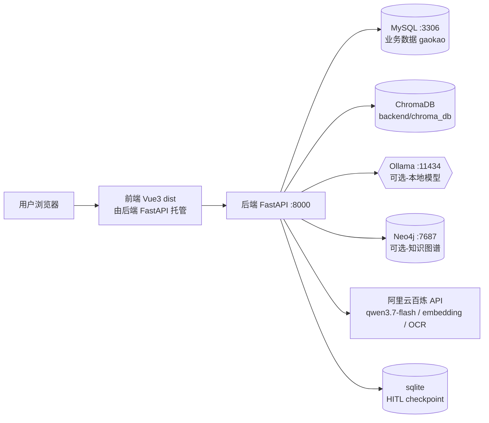

# 高考志愿填报系统 · Docker 部署与联调方案

| 项目 | 内容 |
|---|---|
| 文档版本 | v1.0 |
| 编制日期 | 2026-11-02 |
| 开发方 | 培训学校 · AI 应用开发方向 |
| 协作方 | 培训学校 · 运维方向 |
| 联调目标 | 将「高考志愿填报系统」部署至协作方 Docker 环境，跑通 前端 → 后端 → 数据库 → RAG/AI 全链路 |

---

## 一、联调目标与范围

### 1.1 联调目标

在协作方提供的 Docker 环境中完成系统部署，并验证以下链路可用：

1. **基础链路**：前端页面可访问，登录 / 注册可用；
2. **推荐链路**：输入考生位次，返回「冲稳保」院校推荐；
3. **问答链路（RAG）**：知识库问答正常返回，回答引用真实资料；
4. **增强链路**：知识图谱（Neo4j）、人机协同志愿规划（HITL）按能力可用。

### 1.2 本次范围

| 在范围内 | 不在范围内 |
|---|---|
| 应用镜像构建、容器编排、数据库初始化 | 代码改造、算法调优、Prompt 优化 |
| 部署、冒烟测试、联调排障 | 性能压测、生产级高可用（多副本/负载均衡） |
| 运维侧环境准备与资源评估 | 长期监控告警体系建设 |

---

## 二、项目概述

**一句话**：基于 FastAPI + Vue3 的「河南 2024-2025 录取数据冲稳保推荐 + RAG 知识库」系统，问答链路采用 基础 RAG / 进阶 RAG / Self-RAG / Corrective RAG 等策略，并内置 LangGraph 人机协同（HITL）志愿规划与知识图谱双通道。

### 2.1 技术栈

| 层 | 技术 | 版本要求 | 说明 |
|---|---|---|---|
| 后端 | Python + FastAPI + Uvicorn | Python 3.11+ | 入口 `app.main:app`，端口 8000 |
| 前端 | Vue3 + Vite + TypeScript | Node 18+ | 已构建产物 `frontend/dist`（3.1 MB），由后端托管，无需单独部署 |
| 数据库 | MySQL | 5.7+ / 8.0 | 业务库 `gaokao`，utf8mb4 |
| 向量库 | ChromaDB（本地持久化） | 随 requirements 安装 | 目录 `backend/chroma_db`（约 22 MB），默认集合 `gaokao_knowledge` |
| 本地大模型 | Ollama | 最新 | `qwen3:4b`（问答/Agent）+ `nomic-embed-text`（本地 embedding），**可选** |
| 云端模型 | 阿里云百炼（OpenAI 兼容） | 需 API Key | 文本 LLM `qwen3.7-flash`、向量 `text-embedding-v3`、OCR `qwen-vl-ocr`，**核心链路依赖** |
| 知识图谱 | Neo4j | 5.x / 2025+ | 图谱问答通道，**可选**，未启动自动降级 |
| 人机协同 | LangGraph + sqlite checkpoint | langgraph ≥ 1.0 | HITL 会话落盘 `backend/data/plan_checkpoints.db` |

### 2.2 组件依赖关系



**依赖矩阵**：

| 组件 | 是否必选 | 缺失时的表现 |
|---|---|---|
| MySQL | 必选 | 系统不可用 |
| 阿里云百炼 API | 必选（核心链路） | 问答无结果 / 401 / 超时 |
| ChromaDB 目录 | 必选（问答） | RAG 检索为空，可重建向量库 |
| Ollama | 可选 | 自动回落云端通道；Agent 本地模式不可用 |
| Neo4j | 可选 | 自动降级为「向量 + MySQL」两路，启动日志红字警告 |
| 前端 dist | 必选（页面访问） | 后端返回 404「前端未构建」 |

---

## 三、部署模式

| 模式 | 说明 | 适用场景 | 推荐度 |
|---|---|---|---|
| **模式 A：全容器化** | MySQL + 后端（含前端 dist）全部容器编排，Ollama / Neo4j 按需开启 | 协作方提供全新 Docker 环境 | ★ 推荐 |
| **模式 B：应用容器化 + 已有中间件** | 后端容器化，MySQL / Ollama / Neo4j 使用协作方已有裸机服务 | 协作方已有数据库等基础设施 | 备选 |

> 两种模式仅差异在**连接地址配置**（见 6.4 节地址改写表）。本方案默认按 **模式 A** 编写。

---

## 四、交付物清单（开发方 → 运维方）

联调前，开发方需要向运维方交付以下内容：

| # | 交付物 | 内容 | 说明 |
|---|---|---|---|
| 1 | 代码包 | 项目源码（含 `backend/`、`frontend/dist/`、`deploy/`） | 建议 git 仓库或 zip 压缩包 |
| 2 | 部署编排文件 | `deploy/docker-compose.yml`、`deploy/Dockerfile` | 已随代码包提供 |
| 3 | 环境变量模板 | `deploy/.env.docker.example` | 复制为 `.env.docker` 后填写 |
| 4 | 初始化 SQL | `deploy/sql/*.sql`（建表脚本） | MySQL 容器首次启动自动执行 |
| 5 | **业务数据包**（★ 联调前置确认项） | `gaokao` 库数据 | 见 5.1 节说明 |
| 6 | 知识库预置数据 | `backend/chroma_db/`（向量库 22 MB）+ `backend/knowledge_files/`（知识源文件 41 MB） | 若未随包提供，则需在联调环境重新上传并向量化 |
| 7 | 云端模型密钥 | `Ali_API_KEY` | **敏感项**，建议由开发方在联调现场直接配置，不写入文档/聊天记录 |

### 5.1 业务数据初始化（已确认）

数据库 `gaokao` 除了建表脚本，还需要**录取业务数据**（推荐功能的查询源，也是知识图谱的数据源）。

- **数据源**：HuggingFace 各省高校开源数据，本地存放于 `gaokao_data/data/2025/<省份>/`（共 31 省，每省 5 个文件：`major-admission.csv` / `score-range.csv` / `enrollment-plan.csv` / `school-admission.csv` / `meta.json`）；
- **导入脚本**（开发方实际使用，位于 `temp_导入开源数据/` 目录）：
  - `kan_gaokao_test.py`：各省 `major-admission.csv` 合并 → 表 `major_admission_2025_all`（首省 replace 建表，后续 append 追加）；
  - `kan_gaokao_test2.py`：`score-range.csv` → 表 `score_range_2025_all`；`enrollment-plan.csv` → 表 `enrollment_plan_2025_all`；
  - 连接串写死为 `root:123456@localhost:3306/gaokao`（培训环境统一账号），脚本需在**能直连目标 MySQL 的机器**上运行；
- **联调推荐流程**（二选一）：
  1. **推荐（离线数据包）**：开发方在本机 MySQL 完成导入后执行 `mysqldump -uroot -p123456 gaokao > gaokao_dump.sql`，dump 随交付物提供；运维方在 MySQL 容器就绪后执行 `docker compose exec -T mysql mysql -uroot -p<密码> gaokao < gaokao_dump.sql`；
  2. **现场直导**：将 `gaokao_data/` 与两个导入脚本拷贝至部署机，安装 `pip install pandas pymysql sqlalchemy` 后运行（脚本默认连 `localhost:3306`，容器 MySQL 已映射 3306 时可直连）。

> ⚠ 脚本连接串写死 `root:123456`，若目标 MySQL 密码不同，需先改脚本连接串或统一密码。该数据是推荐功能与知识图谱的**唯一数据源**，未导入则联调卡在推荐链路。

---

## 五、环境与前置检查（运维方）

### 5.1 软件要求

| 软件 | 最低版本 | 验证命令 |
|---|---|---|
| Docker Engine | 20.10+（建议 24+） | `docker version` |
| Docker Compose | v2（建议 v2.20+） | `docker compose version` |

### 5.2 网络要求（模式 A）

| 访问目标 | 用途 | 说明 |
|---|---|---|
| Docker Hub（`docker.io`） | 拉取基础镜像（python、mysql） | 若受限可走离线镜像，见 5.4 |
| 阿里云 MaaS `*.aliyuncs.com` | 文本 LLM / Embedding | **核心链路，必须可达** |
| `maas.qianwenaiapi.com` | OCR / 视觉模型 | OCR 通道独立域名 |
| 阿里云 `*.oss-cn-*.aliyuncs.com`（如启用） | 图注等资源 | 视功能而定 |
| `ollama.com` / 模型仓库（如启用 Ollama） | 拉取本地模型 `qwen3:4b` / `nomic-embed-text` | 模型合计约 5 GB |

### 5.3 资源要求

| 资源 | 最低建议 | 说明 |
|---|---|---|
| CPU | 2 核（4 核更佳） | 无 Ollama 时够用；启用 Ollama 推理建议 8 核 |
| 内存 | 4 GB（启用 Ollama 建议 12 GB+） | Ollama qwen3:4b 推理为主消耗 |
| 磁盘 | 镜像约 2 GB + 数据约 0.5 GB + Ollama 模型约 5 GB | 视是否启用 Ollama 而定 |

### 5.4 离线交付（网络受限时）

若运维环境无法访问 Docker Hub：

```bash
# 开发方本机（需先启动 Docker Desktop 并构建成功）
docker build -t gaokao-backend:latest -f deploy/Dockerfile .
docker pull mysql:8.0
docker save gaokao-backend:latest mysql:8.0 | gzip > gaokao-images.tar.gz

# 运维方
gunzip -c gaokao-images.tar.gz | docker load
```

### 5.5 端口规划

| 端口 | 服务 | 默认映射 | 备注 |
|---|---|---|---|
| 8000 | 后端 + 前端页面 | `8000:8000` | 联调访问入口（浏览器打开 `http://<主机IP>:8000`） |
| 3306 | MySQL | `3306:3306` | 如有冲突可改宿主端口 |
| 11434 | Ollama（可选） | 启用时 `11434:11434` | 仅容器内网需要时可不映射 |
| 7687 / 7474 | Neo4j（可选） | 启用时映射 | Bolt / HTTP 端口 |

> 端口冲突检查（Linux）：`ss -tlnp | grep -E '8000|3306'`；联调前请确认 8000 未被占用。

---

## 六、部署步骤（模式 A 全容器化）

### 6.1 目录结构

将代码包解压到目标目录（示例 `/opt/gaokao`），部署文件已内置：

```
/opt/gaokao/
├── backend/                 # 后端源码（含 knowledge_files 等数据目录）
├── frontend/dist/           # 前端构建产物
├── deploy/
│   ├── docker-compose.yml
│   ├── Dockerfile
│   ├── .env.docker.example
│   └── sql/                 # 初始化 SQL（03/04/05）
└── .dockerignore
```

### 6.2 配置环境变量

```bash
cd /opt/gaokao/deploy
cp .env.docker.example .env.docker
vi .env.docker   # 填写密钥与密码
```

**必填项**：

| 变量 | 填写内容 | 示例 |
|---|---|---|
| `Ali_API_KEY` | 开发方提供的阿里云百炼 API Key | `sk-xxxxxxxx` |
| `DB_PASSWORD` | MySQL root 密码（**自定义，勿用默认**） | `Gaokao@2026` |
| `JWT_SECRET` | 随机长字符串（`openssl rand -hex 32`） | 64 位十六进制 |
| `NEO4J_PASSWORD`（启用图谱时） | Neo4j 密码 | 自定义 |

### 6.3 关键：容器内连接地址改写

> ⚠ **最容易踩的坑**：后端默认配置里的 `localhost` 在容器内指向容器自身，必须按下表改写，否则连不上数据库 / Ollama / Neo4j。

| 变量 | 本机开发值 | 容器内必须改为 | 原因 |
|---|---|---|---|
| `DB_HOST` | `localhost` | `mysql` | 指向 compose 中的 MySQL 服务 |
| `HOST` | `127.0.0.1` | `0.0.0.0` | 否则容器外无法访问后端 |
| `OLLAMA_URL`（启用时） | `http://localhost:11434` | `http://ollama:11434` | 指向 Ollama 服务 |
| `NEO4J_URI`（启用时） | `bolt://localhost:7687` | `bolt://neo4j:7687` | 指向 Neo4j 服务 |

### 6.4 启动

```bash
cd /opt/gaokao/deploy

# 1) 构建镜像（首次构建需拉基础镜像 + 安装依赖，约 5-15 分钟，视网络而定）
docker compose build

# 2) 启动（先起 MySQL 并等待健康检查通过，再起后端）
docker compose up -d

# 3) 查看启动日志，确认无红字错误
docker compose logs -f backend

# 4) 确认容器状态
docker compose ps
```

预期启动日志关键行：

```
[startup] 已建表：...
[startup] RAG: store=... embedding_model=ali ready=True
[startup] OCR: base_url=https://maas.qianwenaiapi.com/... key=set
[startup] Neo4j 连接正常（bolt://neo4j:7687），知识图谱可用     # 或红字 WARN 提示未启动
```

### 6.5 数据库初始化

- **建表**：`deploy/sql/` 下的 03/04/05 三个 SQL 会在 MySQL 容器**首次创建数据卷**时自动执行（`/docker-entrypoint-initdb.d`），日志可见；
- **业务数据**：见 5.1 节，确认 dump 文件并导入；
- **管理账号**：后端启动后由开发方执行 `python backend/scripts/create_admin.py`（容器内执行：`docker compose exec backend python scripts/create_admin.py`），或通过注册接口创建。

### 6.6 启用可选组件

**Neo4j（知识图谱）**：

```yaml
# deploy/docker-compose.yml 中取消 neo4j 服务注释，并设置 NEO4J_PASSWORD
# 启动后还需建库（从 MySQL 构建节点与关系，由开发方执行）：
#   docker compose exec backend python -m app.services.graph.graph_builder --year 2025
```

**Ollama（本地模型）**：

```yaml
# 取消 ollama 服务注释，启动后拉取模型：
#   docker exec gaokao-ollama ollama pull qwen3:4b
#   docker exec gaokao-ollama ollama pull nomic-embed-text
```

> 两者均非必选。不启用时，问答走「向量 + MySQL」两路 + 云端模型，功能完整可用。

---

## 七、联调验证清单

按 P0 → P2 顺序执行，P0 全部通过即视为联调主线打通。

### P0：主线链路（必须全过）

| # | 验证项 | 验证方式 | 预期结果 |
|---|---|---|---|
| 1 | 健康检查 | 浏览器 / curl 访问 `http://<主机IP>:8000/api/health` | 200，`status=ok`，含 `database=gaokao` |
| 2 | 前端页面 | 浏览器访问 `http://<主机IP>:8000` | 页面正常渲染，无白屏 |
| 3 | 登录/注册 | 页面注册学生账号并登录 | 成功，无 500 |
| 4 | 推荐接口 | 页面输入位次（如 50000）生成推荐 | 返回冲/稳/保三档院校列表 |
| 5 | 问答基础链路 | 页面提问「河南大学 2024 年理科最低录取位次是多少」 | 有回答且带引用/资料出处 |

### P1：增强链路

| # | 验证项 | 验证方式 | 预期结果 |
|---|---|---|---|
| 6 | 知识库问答（RAG） | 提问知识库资料相关问题（如学费、培养方案） | 回答基于上传资料，引用正确 |
| 7 | 知识图谱 | 提问「XX 专业有哪些开设院校」（Neo4j 已启用时） | 图谱指示灯绿色，返回结构化结果 |
| 8 | 人机协同规划（HITL） | 生成志愿方案初稿 → 提出修改意见（如「不想去北京」） | 支持多轮修改，最终可定稿；重启后端后会话仍可恢复 |
| 9 | 知识上传/向量化 | 管理端上传 PDF/TXT/DOCX | 状态流转「已上传 → 已向量化」 |
| 10 | 多模态（以文搜图） | 提问含「课程表 / 培养方案图」 | 返回图片或回落文本链路 |

### P2：附加能力

| # | 验证项 | 预期结果 |
|---|---|---|
| 11 | OCR（扫描件 PDF 上传） | 可识别并入库（日志确认 OCR 通道调用） |
| 12 | RAG 评估接口 | `/api/rag/eval` 相关接口可用 |
| 13 | 并发访问 | 多用户同时登录/问答不互相阻塞（认证与 AI 线程池隔离） |

---

## 八、常见问题与排障

| 现象 | 可能原因 | 处理方法 |
|---|---|---|
| 容器内后端连不上 MySQL | `DB_HOST` 仍是 `localhost` | 改为 `mysql`，重启后端 |
| 容器外访问 8000 不通 | `HOST` 未改为 `0.0.0.0` | 修改 `.env.docker` 后 `docker compose up -d backend` |
| 问答返回 401 / 一直失败 | `Ali_API_KEY` 未配置或无效 | 检查 `.env.docker`，确认 base_url 为工作空间专属域名 |
| OCR 一直 404/401 | `OCR_BASE_URL` 与文本通道混用 | OCR 必须用 `maas.qianwenaiapi.com` 域名 |
| 启动日志红字「Neo4j 未启动」 | 未启用图谱 | 按需启用；不影响主线，属预期降级 |
| 问答说「图谱没命中」 | Neo4j 未建库 | 执行 `graph_builder` 建库后再验证 |
| 知识库检索为空 | Chroma 集合为空/维度不一致 | 检查 `chroma_db` 挂载；重新上传知识文件并向量化 |
| 前端 404「前端未构建」 | 镜像内无 `frontend/dist` | 确认构建前 `npm run build`，或重新构建镜像 |
| 数据库中文乱码 | 字符集未指定 | MySQL 已按 `utf8mb4` 配置；dump 导入时确认文件编码 |
| 镜像构建卡在 pip install | 网络 / 依赖编译 | 配置镜像加速；确认为 wheel 依赖无需编译 |
| 端口冲突 | 宿主端口被占 | 修改 compose 端口映射 |

---

## 九、回滚与清理

```bash
# 停止但不删数据
docker compose down

# 完全清理（含数据卷，注意先备份！）
docker compose down -v

# 备份数据
docker compose exec -T mysql mysqldump -uroot -p<密码> gaokao > gaokao_backup_$(date +%F).sql
```

> 数据卷说明：`mysql-data` 存放 MySQL 数据；`chroma_db`、`knowledge_files`、`data`、`reports` 以目录挂载方式直接可见，可直接打包备份。

---

## 十、双方职责分工

| 环节 | 开发方（AI 方向） | 运维方 |
|---|---|---|
| 联调前 | 提供代码包、部署文件、数据包、API Key（现场配置）；确认数据导入方式 | 准备 Docker 环境、检查端口与网络、确认资源 |
| 部署中 | 现场指导配置 `.env.docker`、执行建库/导数据/建账号 | 拉取代码、构建镜像、启动编排、观察日志 |
| 冒烟验证 | 提供 P0 清单并逐项演示 | 协助网络/端口/容器排查 |
| 问题处理 | 定位应用层问题（配置、依赖、代码） | 定位环境层问题（网络、资源、容器） |
| 收尾 | 提供运行说明、常见问题文档 | 记录部署基线、确认资源占用 |

## 十一、今晚联调议程建议

| 时段 | 事项 | 负责 |
|---|---|---|
| 0-15 min | 环境检查（Docker、端口、网络、磁盘）、代码包到位 | 运维 |
| 15-45 min | 配置 `.env.docker`、构建镜像、启动 compose | 双方 |
| 45-60 min | 数据库初始化（建表 + 数据导入 + 管理账号） | 开发主导 |
| 60-90 min | P0 五项冒烟验证（健康检查→页面→登录→推荐→问答） | 开发演示，运维旁站 |
| 90-120 min | P1/P2 按需验证 + 问题修复 + 记录 | 双方 |
| 结束 | 确认 P0 全过，遗留项登记 | 双方 |

---

## 附录 A：常用命令速查

```bash
docker compose ps                  # 查看状态
docker compose logs -f backend     # 跟踪后端日志
docker compose logs mysql | grep -i init   # 查看建表执行情况
docker compose exec backend python scripts/create_admin.py   # 创建管理账号
docker compose exec -T mysql mysql -uroot -p<密码> gaokao    # 进入数据库
curl http://127.0.0.1:8000/api/health                         # 健康检查
```

## 附录 B：本机（开发方）Docker 现状

- Docker CLI 已安装：`Docker 29.4.0`，`Docker Compose v5.1.1`；
- Docker Desktop 守护进程当前**未启动**，联调前在开发机启动 Docker Desktop 即可本地自测镜像构建；
- 若需先本地验证：启动 Docker Desktop → `docker build -t gaokao-backend:latest -f deploy/Dockerfile .` → 参照 6.4 节启动。
